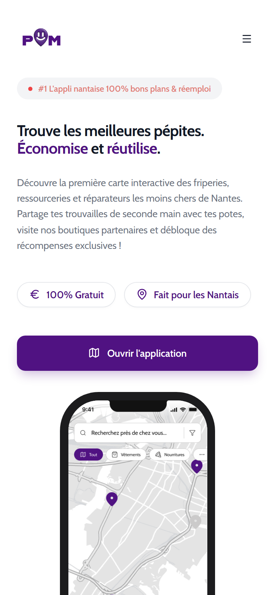
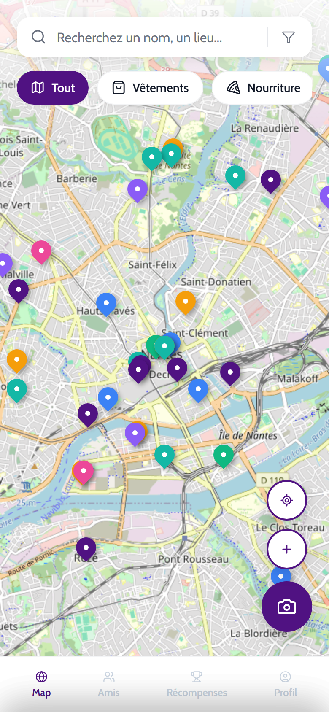
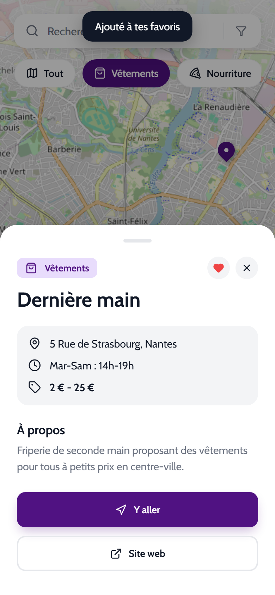
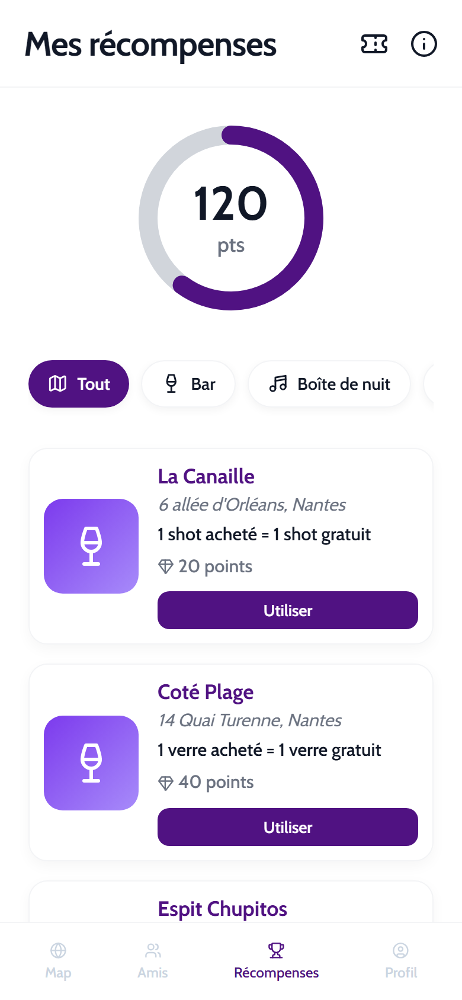
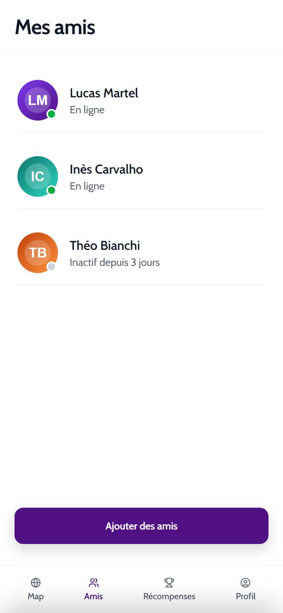
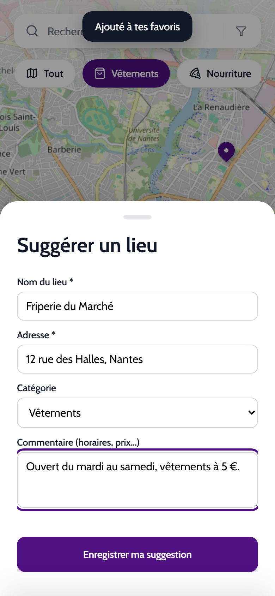
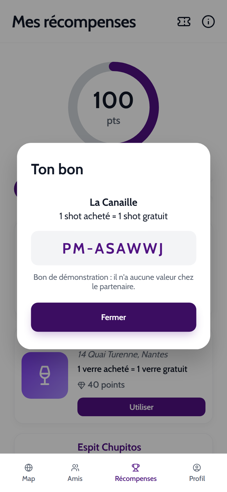
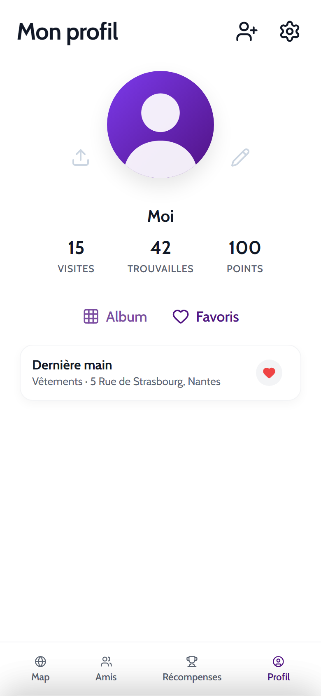
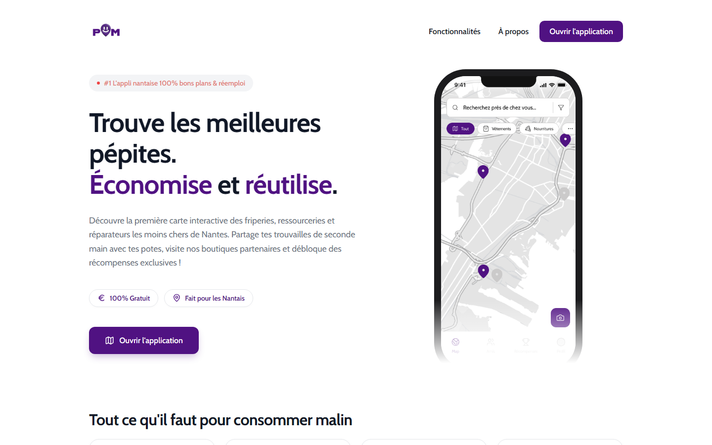
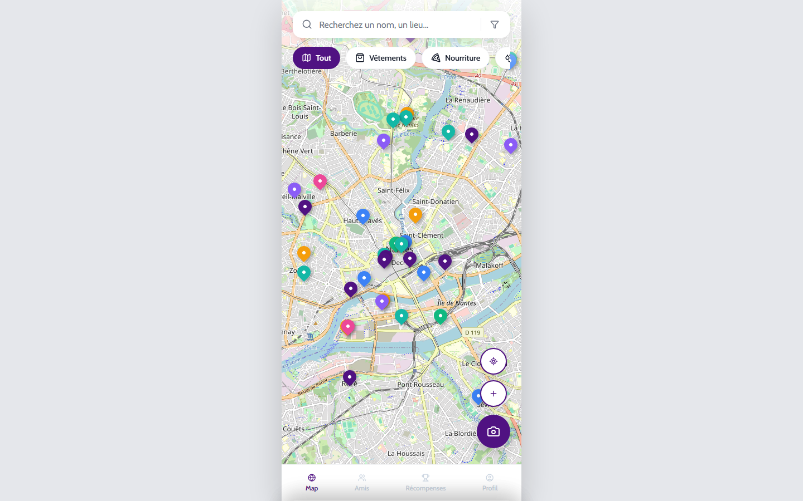

# Plan Malin

Prototype web mobile d'une **carte interactive du réemploi et des bons plans étudiants à Nantes** : friperies, aides alimentaires, hygiène, logement, numérique, accompagnement. Les lieux se filtrent par catégorie et se trouvent par recherche, et une fiche détaillée s'ouvre sur chacun.

Projet de cours réalisé pour l'association *Dernière Main* (le cahier des charges d'origine est conservé dans [docs/CAHIER-DES-CHARGES.md](docs/CAHIER-DES-CHARGES.md)). L'application est un **prototype front-end statique** : pas de serveur, pas de compte, pas de base de données.

## Sommaire

- [Fonctionnalités](#fonctionnalités)
- [Aperçu](#aperçu)
- [Stack technique](#stack-technique)
- [Lancer le projet](#lancer-le-projet)
- [Tests](#tests)
- [Structure du dépôt](#structure-du-dépôt)
- [Choix techniques](#choix-techniques)
- [Limites connues](#limites-connues)
- [Documentation](#documentation)

## Fonctionnalités

Réellement implémentées (chaque bouton visible fait quelque chose) :

| Page | Fonctionnalités |
|---|---|
| `index.html` | Landing page responsive (deux colonnes sur ordinateur, menu déroulant sur mobile) : présentation, fonctionnalités, à propos ; le bouton ouvre l'application. |
| `app.html` | Carte Leaflet de 39 lieux en 8 catégories : filtres par catégorie, recherche (sans casse ni accents), **filtres avancés** (gratuit, avec site, favoris), **géolocalisation**, fiche détaillée avec **favori** (cœur), site web et itinéraire « Y aller ». **Suggérer un lieu** (formulaire enregistré sur l'appareil) et **caméra** (vraie photo, +10 points). |
| `amis.html` | Liste d'amis, fiche d'un ami (album, statistiques stables), **ajout d'amis persistant** depuis les suggestions, **invitation par lien** (partage natif ou copie). |
| `recompenses.html` | Jauge de points, 19 offres filtrables ; **« Utiliser »** déduit les points et crée un bon de démonstration ; **« Mes bons »** liste l'historique ; modale d'aide. |
| `profil.html` | Points à jour, **pseudo et photo modifiables**, **partage** de l'appli, onglet **Album** (photos prises) et onglet **Favoris** (lien vers la fiche sur la carte), **ajout d'ami** (raccourci) et **réglages** (résumé des données, suppression des photos, réinitialisation). |

Il n'y a pas de serveur : points, photos, favoris, amis, bons, suggestions et profil sont stockés dans le navigateur de l'appareil (`localStorage`) et ne sont jamais envoyés. Les amis, avatars, statistiques d'ami et offres reposent sur **des données de démonstration** (voir [Limites connues](#limites-connues)).

**Affichage** : sur mobile, l'application occupe tout l'écran ; sur ordinateur et tablette, elle garde la taille d'un mobile (colonne de 430 px centrée) pour que l'expérience soit identique partout.

## Aperçu

Captures réelles prises avec Chromium (Playwright) sur un serveur local : mobile (390 × 844) puis ordinateur (1440 × 900).

<p align="center">
  
  
  
  
  
</p>
<p align="center">
  
  
  
</p>
<p align="center">
  
  
</p>

Le visuel `assets/img/Accueil - Map.png`, affiché dans le téléphone de la landing page, est une maquette de conception et non une capture de l'interface réelle.

## Stack technique

- HTML, CSS et JavaScript « vanille » (aucun framework, aucune étape de build).
- [Leaflet 1.9.4](https://leafletjs.com/) pour la carte, fond de carte OpenStreetMap.
- [Lucide 1.55.0](https://lucide.dev/) pour les icônes, police Google Fonts *Cabin*.
- Leaflet et Lucide sont chargés depuis unpkg, en version fixée et avec contrôle d'intégrité (SRI).
- Tests : module `node:test` natif de Node.js, sans dépendance.

## Lancer le projet

Prérequis : un navigateur récent, une connexion Internet (CDN et fond de carte) et un serveur HTTP statique quelconque. Python 3 ou Node.js suffit.

```bash
python -m http.server 8000
```

Puis ouvrir <http://localhost:8000/>. Un serveur HTTP est préférable à l'ouverture directe du fichier, et la **caméra exige HTTPS ou `localhost`**. Aucune variable d'environnement n'est nécessaire.

## Tests

Prérequis : Node.js 20 ou plus.

```bash
npm test
```

Les 13 tests vérifient l'intégrité des données et des pages : champs obligatoires des lieux, catégories reliées à un filtre, coordonnées dans la zone nantaise, liens `https`, images et ressources locales existantes, navigation, CDN versionnées avec SRI, zoom non bloqué, identifiants utilisés par `script.js` présents dans les pages, boutons icônes nommés, nombre de lieux annoncé sur la landing page. Il n'existe pas de test automatisé du comportement dans le navigateur ; ce comportement a été vérifié manuellement (voir [docs/AUDIT.md](docs/AUDIT.md)).

## Structure du dépôt

```
index.html        landing page
app.html          carte
amis.html         amis
recompenses.html  récompenses
profil.html       profil
script.js         logique de toutes les pages (sections numérotées, gardées par page)
data.js           données : lieux de la carte et offres de récompenses
style.css         styles (mobile first)
assets/img/       images
tests/            tests d'intégrité
docs/             cahier des charges, audit, récapitulatif, captures (docs/images/)
```

## Choix techniques

- **Pas de framework** : le périmètre (5 pages, pas de backend) ne le justifie pas, et le dépôt s'ouvre sans installation.
- **Données dans `data.js`** : séparées de la logique pour pouvoir les modifier et les tester sans toucher à l'interface.
- **Mobile first** : barre de navigation basse, feuilles modales glissantes, cibles tactiles larges.

## Limites connues

- **Données de démonstration** : amis, avatars, statistiques de profil (visites, trouvailles) et offres de récompenses sont fictifs et ne sont reliés à aucun partenaire réel. Les statistiques d'un ami sont tirées au hasard à chaque ouverture.
- **Bons et points** : le bon généré par « Utiliser » n'a aucune valeur chez les partenaires. Les points (120 au départ, +10 par photo) vivent dans le navigateur ; vider les données du site les remet à 120.
- **Suggestions de lieux, amis, favoris** : enregistrés sur l'appareil uniquement. Aucun envoi ni modération : rien n'alimente la carte pour les autres utilisateurs, et les amis suggérés sont fictifs (le « temps réel » et le vrai réseau d'amis demandent un backend).
- **Photos** : la caméra exige HTTPS ou `localhost`. Les photos sont réduites (480 px) et limitées aux 12 dernières ; aucune vérification qu'elles prouvent une visite.
- **Données de lieux** : 15 lieux sur 39 n'ont pas d'horaires, 6 horaires sont à confirmer (mention « à vérifier »), 5 lieux n'ont pas de site. Les horaires et sites ajoutés proviennent de recherches web (annuaire de Nantes Métropole, sites des structures) et peuvent être périmés. Plusieurs coordonnées sont approximatives. Détail dans [docs/AUDIT.md](docs/AUDIT.md).
- **Statistiques du profil** : « visites » (15) et « trouvailles » (42) sont fixes ; seuls les points évoluent.
- **Landing page** : certaines formulations (« #1 », « boutiques partenaires ») relèvent du discours de présentation.
- Avatars d'amis et photos de profil chargés depuis des sites tiers (`pravatar.cc`, `unsplash.com`), choix conservé pour la démo.
- Fonctionne uniquement en ligne. Les tuiles OpenStreetMap publiques conviennent à un prototype ; une mise en production demanderait un fournisseur de tuiles dédié (voir [docs/AUDIT.md](docs/AUDIT.md), A-13).

## Documentation

- [docs/AUDIT.md](docs/AUDIT.md) : constats détaillés, priorités, vérifications.
- [docs/IMPROVEMENTS.md](docs/IMPROVEMENTS.md) : récapitulatif des améliorations.
- [docs/CAHIER-DES-CHARGES.md](docs/CAHIER-DES-CHARGES.md) : énoncé d'origine.

Aucune licence n'est définie dans le dépôt ; elle reste à choisir par l'auteur.
